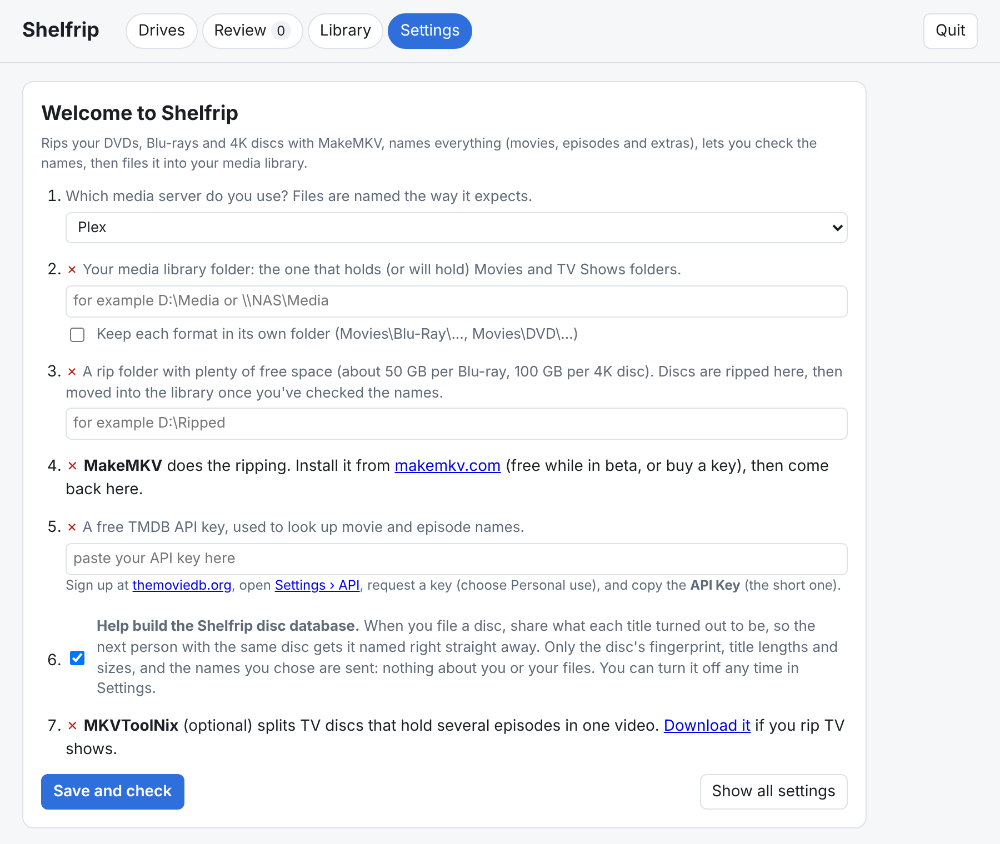

# Shelfrip

Rip DVDs, Blu-rays and 4K discs with MakeMKV, then name movies, episodes and extras automatically
for Plex, Jellyfin, Emby or Kodi.

Load your drives, and Shelfrip rips every disc as you insert it, works out what's on it (the movie,
each episode, every special feature), shows you the proposed names to check, then files everything
into your media library with the folder and file names your media server expects.



## What it does

- **Rips** every title worth keeping as a straight remux (no re-encoding, no quality loss), from
  several drives at once. Auto-rip starts as soon as a disc goes in.
- **Identifies** the disc: movie or TV, which TMDB entry, which title is the main feature, which
  are episodes (and in what order), and which are extras.
- **Names extras** from [TheDiscDB](https://thediscdb.com/) (and optionally DVDCompare) by matching
  run times, and sorts them into Featurettes, Deleted Scenes, Behind the Scenes and so on.
- **Splits TV discs** where several episodes were mastered as one long video, by chapter, with
  MKVToolNix.
- **Keeps every audio and subtitle track**, names commentary tracks properly, and sets your
  language's audio as the default.
- **Lets you review** everything on one page before anything is moved: change a match, rename an
  extra, mark a title as an episode, skip clips. Discs that match with full confidence can be filed
  automatically.
- **Skips what you already have**: a disc whose movie or episodes are already in your library in the
  same or better quality isn't ripped again.
- **Music CDs** too: ripped to FLAC with cyanrip, verified with AccurateRip, named from MusicBrainz,
  with cover art and lyrics.

## Media servers

Pick yours in setup; ripping and review work the same, only the names differ.

| Server   | Folder              | Another cut of a film             | Extras                         |
|----------|---------------------|-----------------------------------|--------------------------------|
| Plex     | `Alien (1979) {tmdb-348}`   | `Alien (1979) {tmdb-348} {edition-Director's Cut}` | `Featurettes\`, `Deleted Scenes\`, ... |
| Jellyfin | `Alien (1979) [tmdbid-348]` | `Alien (1979) [tmdbid-348] - Director's Cut`       | same folders as Plex           |
| Emby     | `Alien (1979) [tmdbid=348]` | `Alien (1979) [tmdbid=348] - Director's Cut`       | same folders as Plex           |
| Kodi     | `Alien (1979)`              | `Alien (1979) - Director's Cut`                    | `Extras\`                      |

TV shows go in `TV Shows\Show (Year)\Season 1\Show (Year) - s01e01 - Title.mkv`. Existing libraries
are recognised whichever style they use, and you can keep each format in its own folder
(`Movies\Blu-Ray\...`, `Movies\DVD\...`) if you like.

## Install (Windows)

1. Install [MakeMKV](https://www.makemkv.com/download/). It does the actual ripping. It's free while
   in beta (use the current beta key from the MakeMKV forum) or you can buy a licence.
2. Download **Shelfrip Setup** from [Releases](https://github.com/VandykeConnor/ShelfRip/releases) and
   run it. No admin rights needed. There's also a portable zip.
3. Open Shelfrip. The first-run setup asks for:
   - your media server,
   - your media library folder (the one holding `Movies` and `TV Shows`),
   - a rip folder with room to spare (about 50 GB per Blu-ray, 100 GB per 4K disc),
   - a free [TMDB API key](https://www.themoviedb.org/settings/api) (sign up, Settings › API, request
     a key for personal use, copy the short "API Key").
4. Optional: [MKVToolNix](https://mkvtoolnix.download/downloads.html) for splitting TV discs, and
   [cyanrip](https://github.com/cyanreg/cyanrip/releases) for music CDs.

Shelfrip runs as a small local app and opens in your browser at `http://127.0.0.1:8765` (only
reachable from your own PC; if another program already uses that port, it picks the next free one). Keep its window open while it works; the **Quit** button on the page
stops it. Your settings live in `%APPDATA%\Shelfrip`.

## Run from source

Needs Python 3.10 or newer on Windows; only the standard library is used.

```
python app.py
```

or double-click `Run Shelfrip.bat`. To build the installer yourself, run `Build Installer.bat`
(needs [Inno Setup 6](https://jrsoftware.org/isdl.php) for the Setup exe; without it you get the
portable zip).

## Where the names come from

- [TMDB](https://www.themoviedb.org/): movie and episode names and numbers (always the main source).
  This product uses the TMDB API but is not endorsed or certified by TMDB.
- [TheDiscDB](https://thediscdb.com/): recognises specific discs and names their titles and extras.
- [TVmaze](https://www.tvmaze.com/) and, with your own key, [OMDb](https://www.omdbapi.com/): second opinions.
- [DVDCompare](https://www.dvdcompare.net/): extras lists by release. Off by default; turn it on in Settings.
- [MusicBrainz](https://musicbrainz.org/), Cover Art Archive and [LRCLIB](https://lrclib.net/) for music.

## The shared disc database

Every disc you file makes the next person's rip of the same disc more reliable. When sharing is on
(you're asked during setup, and it's in Settings), Shelfrip sends what each title on the disc turned
out to be: the movie, which episode, the extra's name and category, or that you skipped it. When
anyone rips that disc later, Shelfrip asks the database first and uses the answer most people agreed
on. An answer only one person has given yet is still used, but the review page says so and the disc
waits for you instead of being filed automatically.

Only the disc's fingerprint, its label, title lengths and sizes, and the names chosen are sent:
nothing about you, your files or your library. Your install is identified by a random id, stored only
as a salted hash. The whole database can be downloaded (CC0) from `/v1/export`. The server code and
how answers are decided are in [server/](server/).

## Roadmap

- A hosted web interface for the review page.

## Legal

Shelfrip doesn't decrypt anything: MakeMKV does the ripping, and you install and license it yourself.
Shelfrip is for organising backups of discs you own. Copyright law differs between countries, and you
are responsible for following the law where you live.

Licensed under the [MIT License](LICENSE.txt). See [THIRD-PARTY-NOTICES.txt](THIRD-PARTY-NOTICES.txt).
